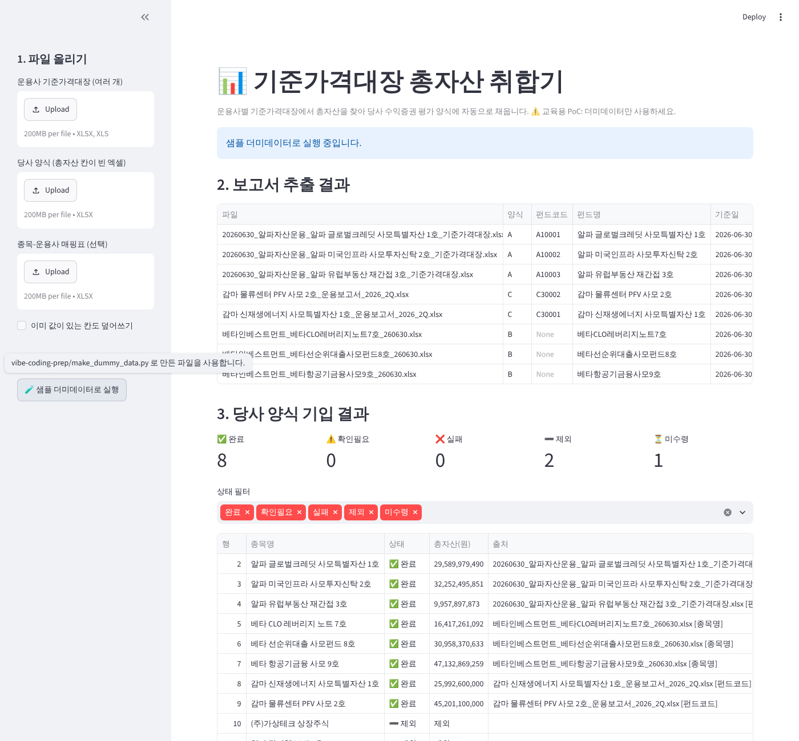

# 📊 기준가격대장 총자산 취합기 (PoC)

운용사마다 양식이 다른 **기준가격대장 엑셀**에서 **총자산**을 찾아, **당사 수익증권 평가 양식**의 해당 종목 칸에 자동으로 채워 주는 웹앱입니다.
나머지 집계는 내부에서 피벗으로 처리하므로, 이 앱은 **총자산 1개 항목**만 다룹니다.

> ⚠️ 교육용 PoC입니다. 실제 회사 데이터는 올리지 말고 `scripts/make_dummy_data.py`로 만든 더미데이터를 사용하세요.



## 빠른 시작

```bash
git clone https://github.com/chochoi4444/project20261014.git
cd project20261014
pip install -r requirements.txt

# (처음 한 번) 더미데이터 생성
python scripts/make_dummy_data.py

# 웹앱 실행 → 브라우저에서 http://localhost:8501
streamlit run app.py
```

왼쪽 사이드바에서 **🧪 샘플 더미데이터로 실행**을 누르면 파일을 올리지 않아도 바로 결과를 볼 수 있습니다.

## 사용 방법

| 단계 | 올릴 파일 | 필수 |
|---|---|---|
| 1 | 운용사 기준가격대장 (`.xlsx`, `.xls`, 여러 개) | ✅ |
| 2 | 당사 양식: `종목명`, `총자산` 컬럼이 있는 엑셀 | ✅ |
| 3 | 종목-운용사 매핑표: `종목명`, `표준코드`, `펀드코드` | 선택 (있으면 펀드코드로 정확하게 매칭) |

결과 화면에서 상태별 건수(완료 / 확인필요 / 실패 / 제외 / 미수령)를 확인하고, **총자산이 채워진 양식**을 내려받습니다.

## 처리 규칙

| 단계 | 내용 |
|---|---|
| 양식 판별 | **A 좌우형** (`작업일자 ▶`, `계정명`) / **B 한 줄 헤더** (`계정과목명`, `당일차변잔액`) / **C 요약형** (`총자산`, `AUM`) |
| 총자산 추출 | A: 코드 `100000` 자산합계의 차변 당일잔액 · B: 코드 `1000000000` `[[ 자산 ]]`의 당일차변잔액 · C: `총자산` 행 (단위 `백만원`/`천원`/`억원` 환산) |
| 펀드 식별 | 펀드코드 → 펀드명 → 파일명(`운용사_펀드명_YYMMDD.xlsx`) 순서 |
| 종목 매칭 | 매핑표 펀드코드 → 종목명 정규화 일치(`Ⅲ`=`III`, 대소문자, `(주)` 무시) → 유사도 85% 이상이면 **확인필요** |
| 제외 | 유가증권분류·구조화기업성격·G/L 계정명에 MMF/ETF, 상장주식(코스닥 등), 신종유가증권/초기투자자금이 있으면 `"제외"` 기입 |
| 검증 | 자산 − 부채 = 순자산 (불일치 시 확인필요), 보고서 기준일 ≠ 양식 기준일 (확인필요) |
| 안전장치 | 이미 값이 있는 칸은 덮어쓰지 않음 (옵션으로 허용), 비고/`AI처리결과` 칸에 사유 기록 |

## 구조

```
project20261014/
├─ app.py                 Streamlit 화면
├─ aggregator/
│  ├─ extract.py          양식 판별 + 총자산 추출
│  └─ fill.py             종목 매칭 + 제외/누락 처리 + 양식 기입
├─ scripts/
│  └─ make_dummy_data.py  가상 기준가격대장·양식·정답지 생성
├─ dummy_data/            생성된 더미데이터 (input / master / target / answer)
├─ tests/                 더미데이터 정답지 비교 테스트
├─ docs/준비가이드.md     교육 사전 준비 가이드 (데이터 항목, 업무 규칙, 우선순위)
└─ requirements.txt
```

## 테스트

```bash
python -m pytest -q tests
```

정답지(`dummy_data/answer/당사양식_정답.xlsx`)와 결과를 행 단위로 비교합니다.

## 새 운용사 양식 추가하기

1. `aggregator/extract.py`의 `detect_format()`에 새 양식의 표식 단어를 추가합니다.
2. `_extract_x(grid, res)` 함수를 만들어 `EXTRACTORS`에 등록합니다.
3. 더미 파일을 만들어 테스트에 추가합니다.

## 알려진 한계

- 엑셀의 첫 번째 시트만 읽습니다. PDF는 지원하지 않습니다.
- 당사 양식을 openpyxl로 저장하므로, 일부 고급 서식(데이터 유효성 검사 확장 등)이 빠질 수 있습니다.
- 보고서에 작업일자가 비어 있으면 기준일 확인이 불가하므로 **확인필요**로 표시합니다.
